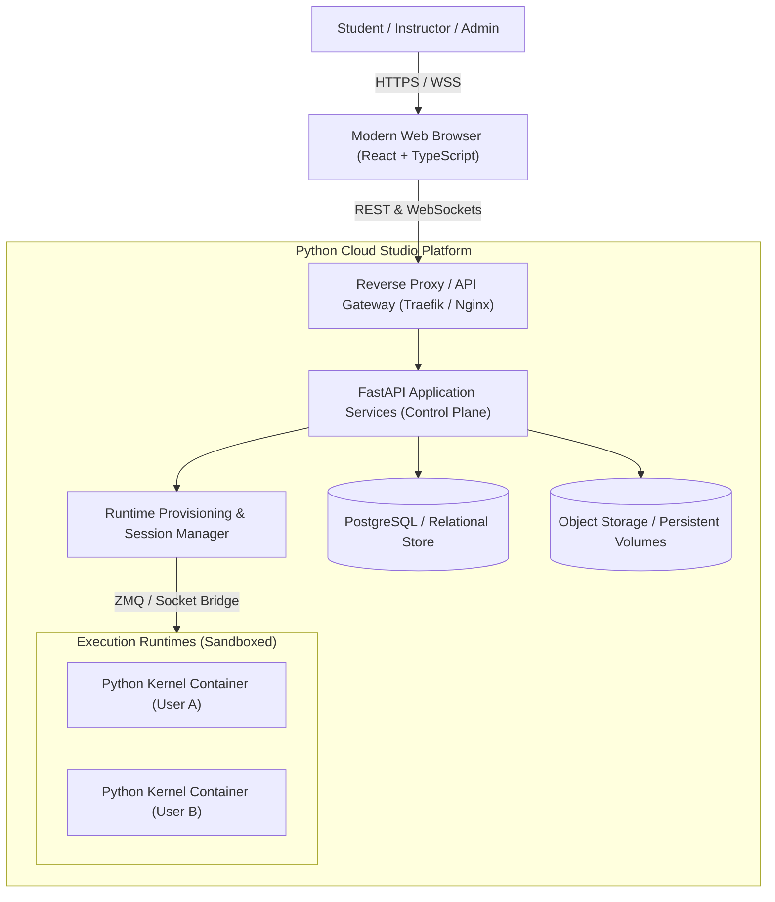

# Enterprise Python Cloud Studio: System Architecture

## 1. Overview & Vision
Enterprise Python Cloud Studio (`python-cloud-studio`) is a production-grade, multi-tenant online Python IDE, notebook workspace, interactive debugger, and collaborative education platform. It provides Google Colab-like ease of use combined with enterprise security, deep Jupyter compatibility, real kernel execution, classroom workflows, and robust isolation.

## 2. Core Architectural Principles
- **Complete Independence**: Zero dependencies, shared databases, or coupled authentication with any external LMS or legacy services.
- **Real Execution**: Every Python cell and script runs via genuine `ipykernel` instances running inside isolated process boundaries.
- **Trust Boundary Separation**: The control plane (FastAPI API and WebSockets) runs as a trusted service, strictly decoupled from untrusted user code execution.
- **Multi-Tenant Authorization**: Strict role-based access control (Student, Instructor, Org Admin, Platform Admin) enforced at the database, API, WebSocket, and file-storage layers.
- **Standard Jupyter Ecosystem Reuse**: Employs `jupyter_client`, Jupyter wire protocol over ZeroMQ / WebSockets, `nbformat` (v4), and the Jupyter Debug Protocol (DAP-backed by `debugpy`).

---

## 3. C4 Architecture Diagrams

### 3.1 Context Diagram (System Context)


### 3.2 Container & Service Boundary (C4 Container Level)
```mermaid
flowchart LR
    subgraph Frontend["Client Applications"]
        WebDash["Web Dashboard (React / Vite)"]
        AdminDash["Admin Console (React / Vite)"]
    end

    subgraph ControlPlaneService["services/api & services/runtime-management"]
        AuthModule["Auth & IAM Service (JWT / OIDC)"]
        NotebookService["Notebook & File Manager"]
        ClassroomService["Classroom & Assignment Service"]
        KernelBridge["Kernel Bridge & ZMQ Protocol Dispatcher"]
    end

    subgraph Runtimes["Untrusted User Execution Realm"]
        KernelZMQ["ZeroMQ Channels (Shell, IOPub, Stdin, Control, HB)"]
        IPyKernel["ipykernel / debugpy (Python 3.14 / 3.12)"]
    end

    Frontend -->|REST APIs| AuthModule
    Frontend -->|REST APIs| NotebookService
    Frontend -->|REST APIs| ClassroomService
    Frontend -->|WebSockets (Jupyter Wire Protocol)| KernelBridge
    KernelBridge -->|ZeroMQ Sockets| KernelZMQ
    KernelZMQ --> IPyKernel
```

---

## 4. Trust Boundaries & Threat Model

| Zone | Trust Level | Components | Access Rules |
|------|-------------|------------|--------------|
| **Zone A: Client** | Untrusted | Browser, JS runtime | Authenticated via Bearer JWT over TLS. |
| **Zone B: Control Plane** | High Trust | FastAPI, DB, Storage | Validates all requests, enforces RBAC, never executes user code directly. |
| **Zone C: Kernel Bridge** | High Trust | Async ZMQ Engine | Translates authenticated WebSockets to kernel ZMQ channels. |
| **Zone D: Execution Runtimes** | Zero Trust | Python kernel, bash processes | Non-root, limited syscalls, egress firewall rules, no metadata service access. |

### Kernel Colocation vs Separate Isolation:
1. **Local Development Mode**: Kernels are spawned by `KernelManager` as subprocesses with unique user session IDs, non-shared ports, and workspace directory path isolation.
2. **Production Kubernetes Mode**: Each session maps to a dedicated container pod spawned via KubeSpawner/Docker runner with memory/CPU limits, dropped capabilities (`CAP_DROP ALL`), read-only root filesystems, and strict network policies blocking access to cloud metadata (`169.254.169.254`) and internal control planes.

---

## 5. Data Model & Database Architecture
The relational database models the complete multi-tenant hierarchy:
- **Tenancy & IAM**: `organizations`, `users`, `organization_memberships`, `roles`, `audit_logs`
- **Workspaces & Storage**: `projects`, `notebooks`, `notebook_versions`, `workspace_files`
- **Runtime Lifecycle**: `runtime_profiles`, `runtime_sessions`, `session_metrics`
- **Classroom & Learning**: `classrooms`, `classroom_members`, `assignments`, `assignment_submissions`, `submission_reviews`
- **Collaboration**: `shared_resources`, `collaboration_sessions`, `invitations`

---

## 6. Execution & Debugging Architecture
- **Protocol**: Standard Jupyter Wire Protocol (v5.3+).
- **Communication Channels**:
  - `shell`: Code execution requests, introspection, complete replies.
  - `iopub`: Broadcast output streams (stdout, stderr), display data (images, HTML, tables), execution status (`busy`/`idle`).
  - `stdin`: Interactive inputs (e.g., `input()`).
  - `control`: Kernel shutdown, interruption, and debugging commands.
  - `heartbeat`: Liveness probes.
- **Debugger**: Implements Debug Adapter Protocol over Jupyter `control` channel using `debugpy`, enabling real breakpoints, step into/over/out, stack inspection, and variable inspection.
