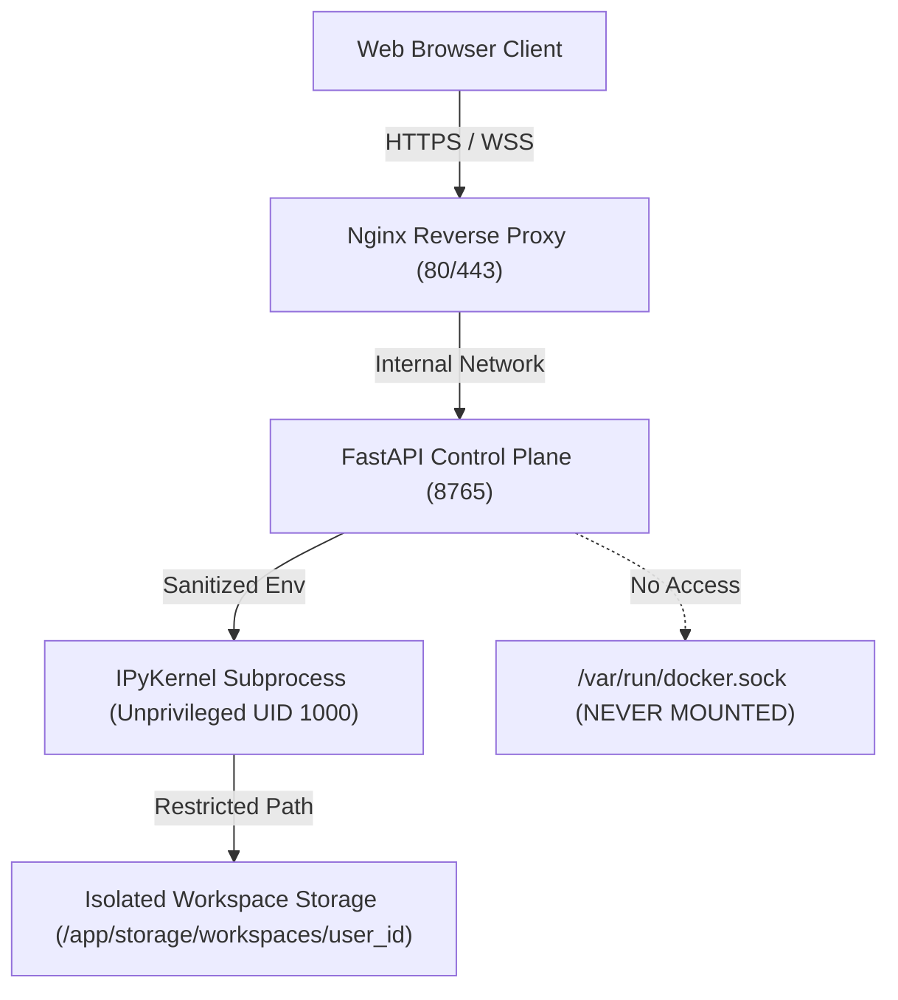

# Enterprise Python Cloud Studio — Production Deployment Guide
## Docker & Linux Server Architecture Manual

---

## 1. System Requirements

### Hardware Specifications

| Specification | Minimum (Staging / Small Team) | Recommended (Production / University) | Enterprise Scale (100+ Concurrent) |
|---|---|---|---|
| **CPU** | 2 vCPUs (x86_64 or ARM64) | 4 to 8 vCPUs | 16+ vCPUs |
| **RAM** | 4 GB | 8 GB to 16 GB | 32 GB to 64 GB |
| **Disk Storage** | 25 GB SSD / NVMe | 80 GB NVMe SSD | 250 GB+ NVMe SSD |
| **Network** | 100 Mbps uplink | 1 Gbps uplink | 1 Gbps+ redundant uplink |
| **Firewall Ports** | Inbound TCP: 80, 443 | Inbound TCP: 80, 443 | Inbound TCP: 80, 443 |

> [!NOTE]
> Python Cloud Studio executes real Python code inside kernel processes. Memory consumption scales with the size of user datasets (e.g., Pandas DataFrames and NumPy arrays). Allocate at least 1 GB of RAM per 3–5 active concurrent executing notebooks.

---

## 2. Supported Operating Systems

Python Cloud Studio is verified for deployment on standard 64-bit Linux distributions:

- **Ubuntu Server:** 24.04 LTS (Noble Numbat), 22.04 LTS (Jammy Jellyfish) — *Recommended*
- **Debian:** 12 (Bookworm), 11 (Bullseye)
- **Rocky Linux / AlmaLinux / RHEL:** 9.x, 8.x
- **Amazon Linux:** 2023

---

## 3. Domain Name & DNS Configuration

Before configuring SSL/TLS certificates, point your domain's DNS `A` or `CNAME` record to your server's public IP address:

1. **Log in to your DNS provider** (Cloudflare, AWS Route53, Namecheap, GoDaddy).
2. Create an **`A` Record**:
   - **Host / Name:** `studio` (or `@` for root domain)
   - **Value / IP:** `YOUR_SERVER_PUBLIC_IP` (e.g., `203.0.113.50`)
   - **TTL:** Auto or 300 seconds
3. Verify DNS propagation from your local terminal:
   ```bash
   dig +short studio.example.com
   # or
   nslookup studio.example.com
   ```

---

## 4. Installing Docker Engine & Docker Compose

Run the following commands on a fresh server to install Docker Engine and the modern Docker Compose plugin (`docker compose` v2).

### Ubuntu / Debian:

```bash
# 1. Update package index and install prerequisites
sudo apt-get update
sudo apt-get install -y ca-certificates curl gnupg lsb-release

# 2. Add Docker's official GPG key
sudo install -m 0755 -d /etc/apt/keyrings
curl -fsSL https://download.docker.com/linux/ubuntu/gpg | sudo gpg --dearmor -o /etc/apt/keyrings/docker.gpg
sudo chmod a+r /etc/apt/keyrings/docker.gpg

# 3. Set up the Docker repository
echo \
  "deb [arch=$(dpkg --print-architecture) signed-by=/etc/apt/keyrings/docker.gpg] https://download.docker.com/linux/ubuntu \
  $(lsb_release -cs) stable" | sudo tee /etc/apt/sources.list.d/docker.list > /dev/null

# 4. Install Docker Engine, CLI, and Docker Compose Plugin
sudo apt-get update
sudo apt-get install -y docker-ce docker-ce-cli containerd.io docker-buildx-plugin docker-compose-plugin

# 5. Enable and start Docker service
sudo systemctl enable docker
sudo systemctl start docker

# 6. (Optional) Allow current user to run Docker without sudo
sudo usermod -aG docker $USER
# Log out and log back in for group changes to take effect
```

### RHEL / Rocky Linux / AlmaLinux 9:

```bash
sudo dnf config-manager --add-repo https://download.docker.com/linux/centos/docker-ce.repo
sudo dnf install -y docker-ce docker-ce-cli containerd.io docker-buildx-plugin docker-compose-plugin
sudo systemctl enable --now docker
```

---

## 5. Uploading or Cloning the Project

### Option A: Clone via Git (Recommended)

```bash
cd /opt
sudo git clone https://github.com/your-org/python-cloud-studio.git
sudo chown -R $USER:$USER /opt/python-cloud-studio
cd /opt/python-cloud-studio
```

### Option B: Upload via SCP or SFTP

From your local machine:
```bash
scp -r ./python-cloud-studio user@your-server-ip:/opt/python-cloud-studio
```

---

## 6. Configuring Environment Variables (`.env`)

Copy the provided template to create your production `.env` configuration:

```bash
cd /opt/python-cloud-studio
cp .env.production.example .env
chmod 600 .env
nano .env
```

### Key Production Variables:

```ini
# Custom Non-Default Application Ports
# Binds strictly to 127.0.0.1:8765 so only the host Nginx reverse proxy can reach it.
# Python Cloud Studio is NEVER exposed directly to the public internet on port 8765.
HOST_BIND_IP=127.0.0.1
HOST_PORT=8765
API_PORT=8765
WEB_PORT=3765
POSTGRES_PORT=5476
REDIS_PORT=6395
DOMAIN_NAME=studio.example.com

# Critical: Generate a secure 64-character secret key:
# Run: openssl rand -hex 32
SECRET_KEY=e839c4d8721ab5092a47834bc671981249fa6b2185437890bc4123985721ad45

# Initial Super Admin Login (Created automatically on first database start)
ADMIN_BOOTSTRAP_EMAIL=admin@example.com
ADMIN_BOOTSTRAP_PASSWORD=SuperSecurePassword2026!#

# PostgreSQL Database Credentials (Custom Port 5476 on internal Docker network pcs-network)
POSTGRES_USER=pcs_user
POSTGRES_PASSWORD=PcsProdDbPassword_Secure9982!
POSTGRES_DB=python_cloud_studio

# Redis Broker (Custom Port 6395 on internal Docker network pcs-network)
REDIS_URL=redis://redis:6395/0

# Storage & Quotas
WORKSPACES_ROOT=/app/storage/workspaces
MAX_CONCURRENT_KERNELS_PER_USER=5
KERNEL_IDLE_TIMEOUT_SECONDS=3600
```

> [!CAUTION]
> Always change `SECRET_KEY`, `POSTGRES_PASSWORD`, and `ADMIN_BOOTSTRAP_PASSWORD` before launching in production!

---

## 7. Starting Application Backend Services

The Docker Compose configuration deploys the application backend (`api`, `postgres`, `redis`) using strictly dedicated custom ports (`8765`, `5476`, `6395`).
Notice that **no Nginx container and no Certbot container are deployed in Docker** — the existing host Nginx installation on `root@vmi3043660` handles reverse proxying.

```bash
# 1. Build and start containers in detached background mode
docker compose up -d --build

# 2. Check container status
docker compose ps
```

Expected healthy output:
```text
NAME           IMAGE                             COMMAND                  SERVICE    STATUS                    PORTS
pcs-postgres   postgres:16-alpine                "docker-entrypoint.s…"   postgres   Up (healthy)              5476/tcp
pcs-redis      redis:7-alpine                    "docker-entrypoint.s…"   redis      Up (healthy)              6395/tcp
pcs-api        python-cloud-studio-api           "uvicorn services.ap…"   api        Up (healthy)              127.0.0.1:8765->8765/tcp
```

> [!IMPORTANT]
> **Custom Non-Default Ports Policy:**
> - **API / Web Studio:** `8765` (bound strictly to `127.0.0.1:8765`)
> - **Frontend Dev Server:** `3765`
> - **PostgreSQL 16:** `5476` (internal to `pcs-network`, zero host port binding)
> - **Redis 7:** `6395` (internal to `pcs-network`, zero host port binding)

---

## 8. Host Nginx Production Configuration (`root@vmi3043660`)

> [!CAUTION]
> **Existing Site Protection Rule:**
> Your production server already hosts other applications (such as `/etc/nginx/sites-available/lms`).
> **Never modify, overwrite, delete, or disrupt existing site configurations, websites, or services.**
> Follow the safe step-by-step procedure below:

### Step 8.1: Pre-Flight Conflict Inspection

Before creating or enabling any configuration, verify there are no domain, port, or directive conflicts:

```bash
# 1. Verify port 8765 is solely occupied by your pcs-api Docker container:
sudo ss -tulpn | grep 8765

# 2. Check all currently active domains to avoid duplicate server_name entries:
grep -rn "server_name" /etc/nginx/sites-enabled/

# 3. Check if map $http_upgrade $connection_upgrade is already declared:
grep -rn "connection_upgrade" /etc/nginx/
```

### Step 8.2: Deploy Isolated Nginx Server Block

Python Cloud Studio provides a dedicated, production-tested configuration at:
`infrastructure/nginx/python-cloud-studio.conf`

Copy this file to Nginx `sites-available`:

```bash
# Copy template into sites-available under its own unique name
sudo cp infrastructure/nginx/python-cloud-studio.conf /etc/nginx/sites-available/python-cloud-studio

# Set permissions
sudo chmod 644 /etc/nginx/sites-available/python-cloud-studio
```

Edit the file to configure your dedicated domain name:
```bash
sudo nano /etc/nginx/sites-available/python-cloud-studio
```

Update `server_name` to your desired domain:
```nginx
server_name studio.yourdomain.com;
```

> [!NOTE]
> If `grep -rn "connection_upgrade" /etc/nginx/` in Step 8.1 revealed that `map $http_upgrade $connection_upgrade` is already defined in `/etc/nginx/nginx.conf` or in another site file, comment out lines 17–20 in `/etc/nginx/sites-available/python-cloud-studio` to prevent a duplicate map warning.

### Step 8.3: Enable the New Site Block

Create a symlink to `sites-enabled`:

```bash
sudo ln -s /etc/nginx/sites-available/python-cloud-studio /etc/nginx/sites-enabled/
```

### Step 8.4: Mandatory Syntax Validation

Always validate Nginx configuration syntax before reloading:

```bash
sudo nginx -t
```

**Expected output:**
```text
nginx: the configuration file /etc/nginx/nginx.conf syntax is ok
nginx: configuration file /etc/nginx/nginx.conf test is successful
```

If `nginx -t` reports any warnings or errors, resolve them before proceeding. Existing websites (like `lms`) remain 100% active and unaffected.

### Step 8.5: Supervised Nginx Reload

> [!IMPORTANT]
> **Approval Safeguard:**
> Never restart or reload Nginx without explicit approval or verification. Once approved, perform a graceful reload (zero downtime for existing sites):

```bash
sudo systemctl reload nginx
```

Verify that both your existing applications (e.g., LMS) and Python Cloud Studio are responding correctly:
```bash
# Check Nginx service health
sudo systemctl status nginx --no-pager
```

### Step 8.6: HTTP Only Protocol

In accordance with deployment requirements:
- Python Cloud Studio operates on **HTTP (Port 80)**.
- **No SSL/TLS certificates or Certbot have been configured at this stage.**
- You can configure SSL certificates (via Certbot or custom certificates) later without modifying the Docker container architecture.

---

## 9. Database Initialization & Admin Account

The database schema, column migrations, guest user account, and primary Super Admin account are **automatically initialized** on first startup by the FastAPI lifespan handler (`services/api/database.py`).

### Creating Additional Administrators

You can promote or create additional Super Admin accounts at any time from the host shell:

```bash
./scripts/create-admin.sh instructor@university.edu "AdminPass2026!" "Dr. Alan Turing"
```

---

## 10. Accessing Python Cloud Studio

Open your browser and navigate to:
```text
http://studio.example.com
# or for local testing:
http://localhost:8765
```

1. **Guest Mode:** Click into any notebook and begin executing code immediately with zero login.
2. **Authenticated Mode:** Click **Sign In** at the top right and enter your `ADMIN_BOOTSTRAP_EMAIL` and `ADMIN_BOOTSTRAP_PASSWORD`.
3. **Super Admin Dashboard:** Click the amber shield **Admin** button in the top navbar to inspect active kernels, audit tenant workspaces, and manage packages.
4. **Interactive Documentation:** Click **Help** in the top navbar to view the complete User Guide and Tutorials.

---

## 11. Production Verification Checklist

Run through this quick verification sequence to ensure all subsystems are functioning:

- [ ] **Frontend Loads:** Web UI loads with clean layout, zero console errors.
- [ ] **Guest Isolation:** Create a file in Guest Mode; verify it appears with `[Public]` badge.
- [ ] **Authentication:** Sign in with Super Admin; verify workspace shifts to `[Private]` badge.
- [ ] **Code Execution:** Create a cell with `print(2 + 2)` and press `Shift+Enter`. Verify output `4` streams via WebSocket.
- [ ] **Interactive Table:** Run `import pandas as pd; pd.DataFrame({'A':[1,2],'B':[3,4]})`. Verify `DataTableView` displays with sort/filter controls.
- [ ] **Package Management:** Run `%pip install rich`. Verify dynamic discovery without kernel restart.
- [ ] **Persistence:** Run `docker compose restart api`. Refresh browser; verify files and notebooks remain intact.
- [ ] **Host Nginx Health:** Verify `sudo systemctl status nginx` is active (running) with zero errors.

---

## 12. Monitoring, Logs & Troubleshooting

### Viewing Real-Time Logs

```bash
# View combined backend logs
docker compose logs -f

# View API application logs
docker compose logs -f api

# View PostgreSQL database logs
docker compose logs -f postgres

# View Host Nginx access and error logs (isolated to Python Cloud Studio)
sudo tail -f /var/log/nginx/python_cloud_studio_access.log
sudo tail -f /var/log/nginx/python_cloud_studio_error.log
```

### Common Troubleshooting Scenarios

#### 1. Nginx Returns `502 Bad Gateway`
- **Cause:** The `api` container is still booting or encountered a startup crash.
- **Diagnosis:** Run `docker compose logs api`.
- **Fix:** Verify database credentials in `.env` match `POSTGRES_USER` and `POSTGRES_PASSWORD`.

#### 2. WebSocket Connection Fails (`Disconnected` status pill)
- **Cause:** Upstream proxy or CDN (e.g. Cloudflare) blocking WebSocket upgrades.
- **Fix:** Ensure Cloudflare WebSockets toggle is **Enabled** under Network settings. In Nginx, verify `proxy_set_header Upgrade $http_upgrade` is active.

#### 3. Kernel Execution Times Out
- **Cause:** Resource starvation or container out-of-memory (OOM).
- **Diagnosis:** Run `docker stats` to check container CPU/RAM allocations.
- **Fix:** Increase container memory limits in `docker-compose.yml` (`deploy.resources.limits.memory: 8G`).

---

## 13. Zero-Downtime Updates & Upgrades

To deploy new versions of Python Cloud Studio without losing user data:

```bash
cd /opt/python-cloud-studio

# 1. Pull latest code from Git
git pull origin main

# 2. Rebuild images in background
docker compose build --pull

# 3. Restart containers with zero workspace data loss
docker compose up -d

# 4. Clean up dangling images to save disk space
docker image prune -f
```

---

## 14. Backup and Disaster Recovery

### Automated Backup

Run the automated backup script to create a compressed archive of both the PostgreSQL database and all user notebooks/workspaces:

```bash
./scripts/backup.sh
```
*Archive saved to:* `./backups/pcs_backup_YYYYMMDD_HHMMSS.tar.gz`

### Restoring from Backup

To restore your entire system onto a fresh server or recover from accidental deletion:

```bash
./scripts/restore.sh ./backups/pcs_backup_20261010_120000.tar.gz
```

### Scheduled Daily Backups via Cron

Add a daily cron job to run backups automatically at 2:00 AM:

```bash
sudo crontab -e
# Add line:
0 2 * * * /opt/python-cloud-studio/scripts/backup.sh >> /var/log/pcs_backup.log 2>&1
```

---

## 15. Security Architecture & Runtime Sandboxing Matrix

### Understanding the Execution Sandbox

Python Cloud Studio executes arbitrary Python code submitted by users. Understanding the exact security boundaries is critical for production compliance:



### Multi-Tier Defense Layers Implemented:

1. **No Docker Socket Mounting:** The Docker daemon socket (`/var/run/docker.sock`) is **NEVER** mounted inside the containers. Users cannot execute Docker commands or escape into the host system.
2. **Resource Constraints:** `docker-compose.yml` enforces explicit `deploy.resources.limits` for CPU, RAM (4G), and process ID count (PIDs: 300) to prevent fork bombs and memory exhaustion.
3. **Environment Sanitization:** When starting a kernel, `get_sanitized_kernel_env()` strips all server environment secrets (`SECRET_KEY`, `POSTGRES_PASSWORD`, `DATABASE_URL`) from the child Python process.
4. **Filesystem Isolation:** Tenant files are segregated into `/app/storage/workspaces/user_{id}/`. Attempts to traverse outside the user directory using `../` are blocked by API validation, regex static inspection, and `sitecustomize.py` path hooks.
5. **No New Privileges:** `security_opt: [ "no-new-privileges:true" ]` prevents privilege escalation via `setuid` binaries.

### Production Scalability & Untrusted Multi-Tenant Code Recommendation

> [!IMPORTANT]
> **Single-Node Docker Compose vs. Enterprise MicroVM Sandboxing**
> 
> - **Educational / Internal Enterprise Use:** The Docker Compose stack provides robust protection for trusted or authenticated academic/enterprise teams through process cgroups, namespace isolation, and environment sanitization.
> - **Public Cloud Untrusted Multi-Tenant Scale (e.g., Google Colab / Kaggle tier):** If your deployment allows anonymous public users to execute completely arbitrary, potentially malicious untrusted C-extensions or kernel exploit payloads, single-node containerization alone should not be considered a 100% hardware boundary. 
> - **Recommended Architecture for Public Scale:** Deploy the runtime engine onto **Kubernetes with gVisor (`runsc`)** or **AWS Firecracker MicroVMs** via Kata Containers. Each user session receives a dedicated microVM with a dedicated lightweight Linux kernel boundary.

